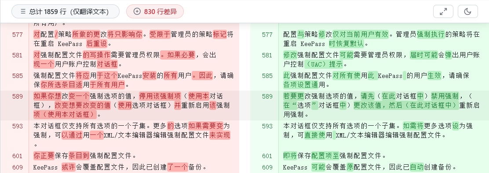

# KeePass 简体中文语言文件（优化版）

本语言文件基于官网简体中文翻译（由 [LeoDou](https://sourceforge.net/u/leodou/) 维护的 v2.58+ 版本）和 KeePass 官方翻译工具 **TrlUtil 2.61** 的内容进行系统性调整、补充与优化，适用于 **KeePass 2.61 及更高版本**。

## 主要改进

1. **术语规范与统一**  
   依据功能的实际含义确定译法，并对高频词汇、菜单项、对话框按钮等做全文件范围的一致性检查与修复。  
   示例：
   - `网址` → **URL**（KeePass 中的 URL 涵盖命令行调用、协议处理、动态占位符等，远超“网页地址”的范畴）
   - `击键序列` → **执行步骤**；`序列` → **步骤**（原为程序语言，不易直观理解）
   - `主密钥` → **管理密钥**；`帐户` → **账户**；`过滤器` → **筛选器**；`恢复` → **还原**

2. **修正错误与显示异常**  
   修正拼写笔误与词义错译，并清除混入的不可见字符。  
   示例：
   - `WindowsOS` 原译“窗口” → **Windows**（此处实际指 Windows 操作系统，而非窗口）
   - `停用` → **禁用**（统一为全文的“启用 / 禁用”表述）
   - 清除多处文本行尾混入的零宽空格（不可见字符，会导致界面出现莫名空白或对齐异常）

3. **去除口语化与翻译腔**  
   将口语化表述与欧化长句调整为简洁、专业的书面表达。  
   示例：
   - 可通过使用 XML/文本编辑器编辑强制配置文件来实现 → **可直接使用 XML/文本编辑器编辑强制配置文件**
   - 由于标准 Windows 文件窗口因安全原因无法… → **出于安全原因，标准 Windows 文件窗口无法…**
   - 当当前数据库与其他…数据库同步时 → **若当前数据库与其他…数据库同步，**

4. **修正语义偏差**  
   对语义存在偏差的翻译进行修正，使表述更贴合实际使用场景。  
   示例：
   - `Compute parameters that lead to a delay of 1 second on this computer.` → **测算并自动设置使当前电脑解锁延迟 1 秒的加密参数。**
     > 在 KeePass 中，这个“1 秒延迟”是刻意为之的安全设计（Key Derivation Function 的工作因子）。目的是拖慢解锁速度，以此抵御暴力破解。
   - 新的文件内容与 KeePass 写入的数据不一致… → **数据库文件保存失败，KeePass 未能成功写入数据（该文件可能已损坏）。**
   - `Up to date` → **已是最新版本**（原“更新”）

5. **统一表述视角**  
   界面文本不再直接称呼用户，改用陈述或祈使句式，读起来更简洁专业；去除全部第二人称“您 / 你”。  
   示例：
   - 您的数据将保存为本地 KeePass 数据库文件… → **数据将保存为本地 KeePass 数据库文件…**
   - 您是否已了解导入流程并准备开始导入？ → **是否已了解导入流程并准备开始导入？**

6. **格式与符号规范**  
   统一中文标点、UI 元素引用、快捷键标注与空格使用，使界面显示更整洁。  
   示例：
   - 点击 [确认] … → **点击【确定】…**（UI 元素引用改用全角方括号，并与按钮实际名称保持一致）
   - “工具”->“选项”->“集成” → **“工具”→“选项”→“集成”**
   - 已忽略{PARAM}个分组 → **已忽略 {PARAM} 个分组**；UUID（&I） → **UUID(&I)**

7. **补充缺失条目**  
   针对 KeePass 2.61 新增的功能和设置项，补充了对应的简体中文翻译。

## 审核方式

- **rev2（本版）**：由 AI 助手 **Hy4 preview** 在本仓库维护者的要求与逐条确认下完成优化。参照依据为 KeePass 作者 **Dominik Reichl** 本人维护的**德语原版（2.61）**（作为主要语义参照），并结合英文条目名与英文界面术语、对照**微软中文 UI 规范**逐条核对概念与译法。
- **早期版本**：由 AI（DeepSeek）辅助检测与建议调整。
- 全部改动均经人工逐条审核与微调后写入，确保翻译准确、自然、符合软件使用场景。

## 优化目录

点击上方预览图可打开**在线完整对照**。若无法访问，也可下载仓库内源文件：
[CleanDiff_2.58_zh-cn_vs_v2.61-rev2.htm](./CleanDiff_2.58_zh-cn_vs_v2.61-rev2.htm)

## 使用方法

1. 下载本仓库中的 `Chinese_Simplified.lngx` 文件。
2. 将其放入 KeePass 安装目录下的 `Languages` 文件夹（若没有请自行创建）。
3. 启动 KeePass，依次点击 `View` → `Change Language`，选择 `Chinese (Simplified)`。
4. 按提示重启 KeePass 即可生效。

## 版本说明

- **当前版本**：rev2（相对 rev1 优化 169 处文本）
- **适用于 KeePass 版本**：2.61+ （建议使用最新稳定版）
- **基于官方翻译版本**：v2.58+（LeoDou）
- **翻译工具**：TrlUtil 2.61

## 反馈

如发现任何翻译问题或改进建议，欢迎提交 Issue 或 Pull Request。

---  
*本语言文件为非官方翻译优化版，旨在提供更好的简体中文使用体验。*
